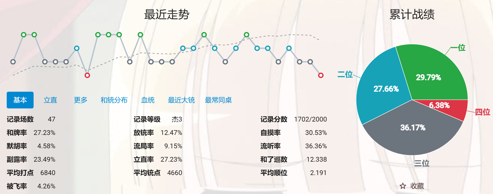

# train_mj：立直麻将 AI 训练与推理工程

`train_mj` 是一个面向四人立直麻将的研究型 AI 工程。项目以天凤牌谱为主要数据源，覆盖事件解析、规则回放、合法动作生成、监督样本构建、多任务训练、离线评估、阈值校准和 HTTP 推理服务。

本项目关注的不只是“训练出一个模型”，而是建立一条可复现、可诊断、可持续迭代的完整链路：

```text
天凤 XML
  -> 标准化事件
  -> 规则状态回放
  -> 合法动作候选
  -> turn / response 样本
  -> 单任务或多任务训练
  -> 离线评估与错误分析
  -> 推理 API
```

> [!IMPORTANT]
> 本仓库仅授权用于个人学习、教学和非商业研究。禁止商业使用、付费服务、赌博、作弊、代打、刷分、未经平台许可的自动化对局，以及任何违法或损害第三方权益的用途。完整条款见 [LICENSE](LICENSE)。
>
> 由于许可证包含非商业限制，本项目属于“源码公开（source available）”，不属于 OSI 定义下的开源软件。

## 实战记录

下图是项目模型在雀魂四人麻将段位场中的一组阶段性实战记录：



截图记录了 `47` 场对局，账号段位为 **雀杰 3**，段位分 `1702 / 2000`，平均顺位 `2.191`；一至四位率分别为 `29.79% / 27.66% / 36.17% / 6.38%`。

雀魂四人麻将的主要段位顺序为：

```text
初心 -> 雀士 -> 雀杰 -> 雀豪 -> 雀圣 -> 魂天
```

除魂天外，每个主要段位又分为 1、2、3 三个阶段。因此，**雀杰 3（简称“杰三”）是雀杰段位的最高阶段，再晋一级即为雀豪 1**。它可以说明系统已经具备一定的牌效率、攻守判断和真实段位环境对局能力，但并不等同于顶尖水平、职业水平或已经稳定达到雀豪。

这张截图是实战展示，不是严格的模型基准：

- `47` 场样本仍然很小，麻将结果具有显著方差。
- 段位和顺位会同时受到匹配环境、对手强度、版本、策略阈值与运气影响。
- 更可靠的结论需要结合更长周期实战、固定牌谱回放、离线指标和错例分析。

雀魂官方对段位顺序的说明可参考 [雀魂简明入门指南](https://mahjongsoul.com/startguide/)。

## 为什么立直麻将 AI 难以训练

立直麻将不是普通的静态分类问题。一个可用系统必须同时处理规则、信息、决策和工程上的多重困难。

### 1. 不完全信息与高随机性

模型只能看到自己的手牌、公开牌河、副露、立直状态和剩余牌数，无法直接知道对手手牌与牌山顺序。相同决策在不同隐藏状态下可能得到完全不同的结果，单局输赢不足以评价动作质量。

### 2. 动作空间随局面变化

切牌、立直、摸和、吃、碰、杠、荣和、流局声明等动作并非始终可用。规则引擎必须先正确生成合法候选，模型才能排序；赤五、振听、抢杠、立直后限制、役种和途中流局等边界都会影响标签正确性。

### 3. 奖励延迟且目标相互制约

局部目标包括牌效率、和牌率、打点、放铳风险与局收支，整场目标又更关心最终顺位和避四。更激进的策略可能提高和牌率，却同时增加放铳率；只优化单一指标容易得到实战上失衡的模型。

### 4. 牌谱监督不等于最优策略

监督学习只能模仿数据中的玩家选择。牌谱包含不同水平、风格和局面判断，也缺少“如果选择另一个动作会怎样”的反事实标签。高频切牌样本还会淹没立直、杠、和牌等少数但关键的动作。

### 5. 离线准确率与实战表现存在差距

`top-1 accuracy` 高不代表对局策略一定更强。错误鸣牌、漏鸣、危险牌选择等少量错误可能显著影响最终顺位，因此需要分类指标、风险指标、阈值校准、固定案例与线上实战共同验证。

### 6. 数据与训练成本高

原始牌谱需要经过解析、回放验证、样本构建和特征预编码。任何事件 schema、规则语义或特征维度变更，都可能要求重建数据集并重新训练。大规模实验还涉及多进程构建、GPU 吞吐、DDP 一致性和可复现性。

## 已实现能力

### 数据与规则

- 解析天凤 XML，并写出标准化的 Parquet 事件分片。
- 回放对局状态，校验事件一致性与标签合法性。
- 生成 `turn` 与 `response` 决策候选及训练样本。
- 支持赤五、副露、立直、振听、抢杠、暗杠、加杠、九种九牌等关键边界。
- 按 `game_id` 生成互斥的 `train / valid / test` manifest。
- 在数据构建阶段预编码状态和候选特征，减少训练阶段的重复计算。

### 模型与训练

- 共享麻将状态编码器。
- `turn_head`：自家回合的切牌、立直、和牌及杠等决策。
- `response_head`：对他家出牌或加杠的通过、鸣牌及和牌决策。
- 支持单任务训练、多任务训练、类别加权和 DDP。
- 保存 resolved config、训练指标、最佳 checkpoint 与最终 checkpoint。

### 评估与推理

- 输出 loss、top-k、macro top-k、分类聚合及少数类指标。
- 支持 response 的 `pass_bias` 与无役鸣牌惩罚校准。
- 支持 response/turn 错例抽样、单样本检查和事件上下文回溯。
- 提供 FastAPI 推理接口：
  - `GET /health`
  - `GET /v1/models`
  - `POST /v1/predict/turn`
  - `POST /v1/predict/response`

当前更详细的训练结果、默认 checkpoint 取舍和已知边界见 [项目状态](docs/status.md)。

## 快速开始

### 环境要求

- Python `3.10+`
- 本地 smoke 测试可使用 CPU 或 CUDA
- 大规模训练建议使用 CUDA GPU

创建环境并安装依赖：

```bash
python -m venv .venv
```

Windows PowerShell：

```powershell
.\.venv\Scripts\Activate.ps1
python -m pip install --upgrade pip
pip install -e ".[dev,training,api]"
```

Linux/macOS：

```bash
source .venv/bin/activate
python -m pip install --upgrade pip
pip install -e ".[dev,training,api]"
```

运行测试：

```bash
python -m pytest
```

查看命令：

```bash
python -m mjai.cli --help
```

## 最小数据闭环

仓库提供 `tests/fixtures/tenhou` 作为本地 smoke 数据。以下命令会依次完成牌谱解析、事件验证、样本构建和数据集切分：

```bash
python -m mjai.cli preprocess \
  --input tests/fixtures/tenhou \
  --output data/bronze_events

python -m mjai.cli validate-events \
  --input data/bronze_events \
  --report outputs/reports/event_validation.json

python -m mjai.cli build-dataset \
  --input data/bronze_events \
  --output data/silver_samples \
  --workers 8 \
  --skip-validation

python -m mjai.cli make-manifest \
  --input data/silver_samples \
  --output data/manifests
```

`validate-events` 确认 `files_failed=0` 后，可以在 `build-dataset` 中使用 `--skip-validation`，避免重复回放验证。Windows 建议从 `6` 或 `8` 个构建进程开始；训练机可根据 CPU、内存、NVMe 利用率和 CLI 的 `samples_per_s` 再调高。

## 训练、评估与服务

本地 smoke 训练：

```bash
python -m mjai.cli train --config configs/turn_local_smoke.yaml
python -m mjai.cli train --config configs/response_local_smoke.yaml
```

离线评估：

```bash
python -m mjai.cli eval \
  --ckpt outputs/checkpoints/turn_local_smoke/best.pt \
  --split valid \
  --report outputs/checkpoints/turn_local_smoke/eval_valid.json
```

检查样本与回溯案例：

```bash
python -m mjai.cli inspect-sample --dataset data/silver_samples --index 0
python -m mjai.cli dump-case \
  --game-id <game_id> \
  --kyoku-id <kyoku_index> \
  --step-id <step_index>
```

启动本地推理 API：

```bash
python -m mjai.cli serve-api --config configs/api_local.yaml
```

调用 API 前，请先把 `configs/api_local.yaml` 中的 checkpoint 路径改为本机实际文件。当前 API 要求调用方传入 `legal_actions`，服务端完整合法动作生成和在线对局 session 尚未实现。

P800/Linux 环境也可以使用仓库根目录的 `start.sh` 串起完整链路：

```bash
./start.sh
TASKS=turn ./start.sh
TASKS=response ./start.sh
CLEAN_DATA=1 RUN_CALIBRATION=1 ./start.sh
```

## 项目结构

```text
train_mj/
├─ mjai/
│  ├─ data/          # 天凤解析、事件 schema、数据集构建与读取
│  ├─ rules/         # 牌表示、状态回放、合法动作与计分边界
│  ├─ features/      # 状态、历史与候选动作特征
│  ├─ models/        # 共享编码器、单任务与多任务策略网络
│  ├─ training/      # loss、指标、优化器与训练引擎
│  ├─ eval/          # 离线评估、校准与错例抽样
│  ├─ serving/       # checkpoint 加载与推理内核
│  └─ api/           # FastAPI 路由与请求 schema
├─ configs/          # 数据、模型、任务、训练与服务配置
├─ tests/            # 单元测试、集成测试与确定性夹具
├─ docs/             # 架构、工程、训练、规则和状态文档
├─ data/             # 本地生成的数据，不应提交
└─ outputs/          # 本地日志、报告与 checkpoint，不应提交
```

## 文档导航

- [文档索引](docs/README.md)：完整阅读顺序。
- [项目状态](docs/status.md)：当前结果、默认模型组合、缺口和下一步。
- [架构方案](docs/architecture-plan.md)：数据、规则、模型与训练策略。
- [工程指南](docs/engineering-guide.md)：目录、配置、CLI 和工程约定。
- [本地 smoke 流程](docs/smoke-training.md)：从夹具到训练与评估。
- [模型输入](docs/model-inputs.md)：状态和动作特征 schema。
- [多任务训练](docs/multitask-training.md)：多任务、DDP 与历史实验结论。
- [规则覆盖](docs/rule-coverage.md)：已支持规则与明确的边界。
- [Serving/API 设计](docs/serving-api-plan.md)：推理服务的分层与接口。
- [版本记录](CHANGELOG.md)：版本变化摘要。

## 已知限制

- 规则引擎仍不是完整的立直麻将规则与计分实现。
- API 当前只负责在调用方提供的合法候选集合中排序。
- 仓库不包含原始商业牌谱、私有数据、训练 checkpoint 或平台凭据。
- 离线模型指标不能直接等同于长期段位表现。
- 本项目仍处于研究与工程迭代阶段，不保证决策正确性、服务稳定性或对任何平台版本持续兼容。

## 使用声明与许可证

本项目公开代码是为了学习、教学、复现实验和非商业研究。使用者必须遵守所在地法律、数据来源条款及游戏平台规则。

明确禁止：

- 将本项目或其衍生模型用于商业产品、收费服务、广告变现或其他营利活动。
- 用于赌博、代打、刷分、作弊、批量账号、破坏公平匹配或规避平台风控。
- 未经平台授权接入线上对局、控制真实账号或进行高频自动化操作。
- 侵犯牌谱、软件、商标、隐私或其他第三方权利。
- 用于任何违法、欺诈、骚扰、攻击或其他不正当行为。

允许的非商业修改与再分发必须保留版权声明、完整许可证、用途限制和修改说明。详细授权条款以 [LICENSE](LICENSE) 为准。

## 免责声明

本项目与雀魂、天凤、Catfood Studio、Yostar、Soul Games 及其关联方不存在官方隶属、授权或背书关系。项目中提及的产品名和商标归各自权利人所有。

代码和模型按“原样”提供，不附带任何明示或默示保证。使用者应自行承担因训练、部署、数据处理、账号行为或第三方索赔产生的全部风险与责任。
